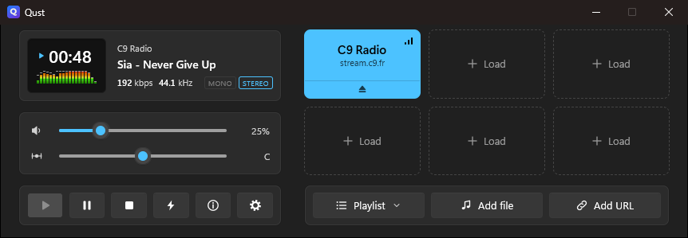

# Qust

<div align="center"></div>

&nbsp;
&nbsp;
&nbsp;

### <div align="center">Efficient, cartridge-loaded, streaming software player</div>

&nbsp;
&nbsp;
&nbsp;
&nbsp;

<div align="center"></div>

&nbsp;


**Qust** is an open-source, simple, **qu**ick **st**reaming player.
  - Native Rust core: the whole audio and stream engine is compiled native code, so it starts instantly, decodes efficiently and uses very little CPU and memory,
  - Built-in stream engine: its own engine reads song titles and stream details directly,
  - Lightweight interface layer: the interface is drawn natively by the content engine that's part of the operating system itself, already installed and kept up to date,
  - Small and light: a 3.5 MB installer, with nothing extra bundled,
  - Features a cartridge-loading concept: six slots, saved with your volume, balance and settings,
  - Playlist drawer: drop music files, folders or .m3u / .pls lists, or add any stream or online audio file. Files play from where they are, with seeking,
  - Reconnects by itself when a stream drops or stalls,
  - Classic pixel spectrum analyzer that follows the sound precisely, with volume and balance controls,
  - Shows the current song (ICY metadata), bitrate, sample rate and mono/stereo,
  - Stream information window with format, network, stability and ICY details,
  - Customizable global shortcuts (Ctrl + Alt + Insert / Ctrl + Alt + H by default),
  - Background helper: starts with Windows in the tray, so shortcuts work even while Qust is closed,
  - Updates itself from the GitHub releases (checks every 8 hours, installs when you restart),
  - Windows 11 look: light and dark themes, your accent color, system menus,
  - Compatible with all HTTP streaming servers (Icecast, SHOUTcast v2),
  - Supports Windows and macOS.

## Building

Qust is a [Tauri](https://tauri.app) app. You need [Node.js](https://nodejs.org) and [Rust](https://rustup.rs), plus the Visual Studio C++ build tools on Windows or the Xcode command line tools on macOS.

```sh
npm install
npm start        # run in development
npm run build    # app and installer, copied to build/bin/
```

Every push to `main` is built on GitHub Actions for Windows and macOS. Bumping the version in `package.json` publishes a [release](https://github.com/mkpascal/qust/releases), which installed copies of Qust update to.
